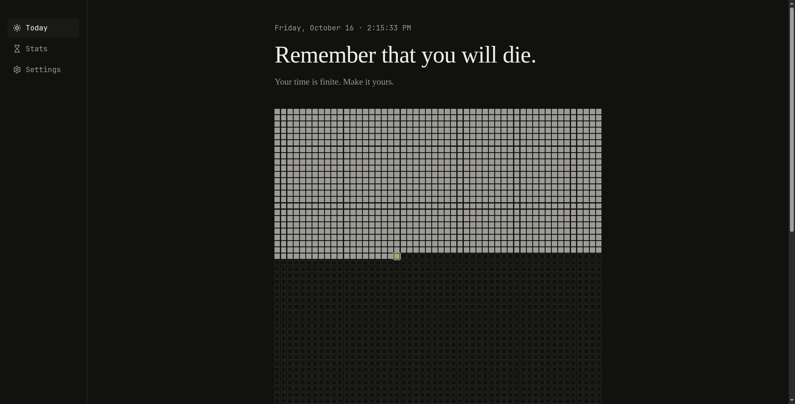

# ✦ Memento Mori

> *“You could leave life right now. Let that determine what you do and say and think.”* — Marcus Aurelius

**Remember that you must die. Remember, so you can truly live.**

Memento Mori is a minimalist web application built around a simple but powerful idea: **your time is finite, and every day matters.**

Visualize the passage of your life, confront the reality of limited time, and become more intentional about how you spend it. Rather than treating time as an endless resource, Memento Mori turns it into something tangible — a quiet reminder to focus on what truly matters.

## ✦ Philosophy

We often live as if we have unlimited tomorrows. We postpone our ambitions, overlook the present, and forget that time is the one resource we can never recover.

Memento Mori exists to challenge that mindset.

- **Awareness over autopilot** — See your time instead of letting it slip away unnoticed.
- **Presence over procrastination** — Give today the attention it deserves.
- **Intention over distraction** — Spend your days on things that matter.
- **Action over regret** — Start living the life you keep planning.

This isn't about fearing death. It's about remembering life.

## ✦ Features

- **Visual Life Calendar** — See the passage of your life represented visually.
- **Minimalist Interface** — A clean, distraction-free experience designed around clarity.
- **Automatic Time Tracking** — Calculate elapsed time and remaining time from your personal timeline.
- **Personalized Timeline** — Configure your birth date and life expectancy to make the calendar your own.
- **Responsive Design** — Access your timeline across desktop, tablet, and mobile devices.
- **Privacy-Conscious Experience** — Keep personal details under your control, depending on the application's storage implementation.


## ✦ Preview

_Add a screenshot or GIF of the application here._

```markdown

```

Replace the image path with the actual location of your screenshot.

## ✦ How to Use

1. Open the application.
2. Enter your birth date and desired life expectancy, if prompted.
3. Explore your visual life calendar.
4. Reflect on the time that has passed and the time that remains.
5. Use that awareness to make more deliberate choices today.


## ✦ A Final Reminder

You don't need to know exactly how much time you have left.

You only need to remember that you have less than you think.

**Memento Mori. Memento Vivere.**

*Remember death. Remember to live.*

---
# ✦ Memento Mori

> *“You could leave life right now. Let that determine what you do and say and think.”* — Marcus Aurelius

**Remember that you must die. Remember, so you can truly live.**

Memento Mori is a minimalist web application built around a simple but powerful idea: **your time is finite, and every day matters.**

Visualize the passage of your life, confront the reality of limited time, and become more intentional about how you spend it. Rather than treating time as an endless resource, Memento Mori turns it into something tangible — a quiet reminder to focus on what truly matters.

## ✦ Philosophy

We often live as if we have unlimited tomorrows. We postpone our ambitions, overlook the present, and forget that time is the one resource we can never recover.

Memento Mori exists to challenge that mindset.

- **Awareness over autopilot** — See your time instead of letting it slip away unnoticed.
- **Presence over procrastination** — Give today the attention it deserves.
- **Intention over distraction** — Spend your days on things that matter.
- **Action over regret** — Start living the life you keep planning.

This isn't about fearing death. It's about remembering life.

## ✦ Features

- **Visual Life Calendar** — See the passage of your life represented visually.
- **Minimalist Interface** — A clean, distraction-free experience designed around clarity.
- **Automatic Time Tracking** — Calculate elapsed time and remaining time from your personal timeline.
- **Personalized Timeline** — Configure your birth date and life expectancy to make the calendar your own.
- **Responsive Design** — Access your timeline across desktop, tablet, and mobile devices.
- **Privacy-Conscious Experience** — Keep personal details under your control, depending on the application's storage implementation.


## ✦ Preview

_Add a screenshot or GIF of the application here._

```markdown

```

Replace the image path with the actual location of your screenshot.

## ✦ How to Use

1. Open the application.
2. Enter your birth date and desired life expectancy, if prompted.
3. Explore your visual life calendar.
4. Reflect on the time that has passed and the time that remains.
5. Use that awareness to make more deliberate choices today.


## ✦ A Final Reminder

You don't need to know exactly how much time you have left.

You only need to remember that you have less than you think.

**Memento Mori. Memento Vivere.**

*Remember death. Remember to live.*

---
